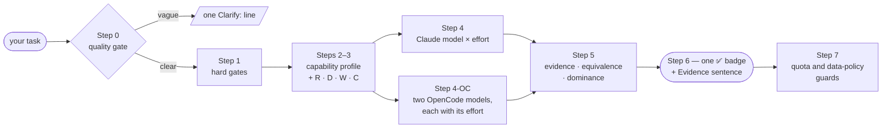

<div align="center">



<br>

[](LICENSE)
[](#-install)
[](#-install)
[](#-install)
[](CHANGELOG.md)
[](#-validation)

**[Install](#-install)** · **[Demo](#-see-it-work)** · **[How it works](#-how-it-decides)** · **[Examples](#-examples)** · **[Evidence](#-built-on-evidence-not-vibes)** · **[Changelog](CHANGELOG.md)** · **[🇹🇷 Türkçe](README.tr.md)**

</div>

<br>

> **Paste a task. Get told which model and effort level to run it on — for Claude and for your OpenCode Go plan — and which of the two to use.**
> It does *not* run the task. It routes it.

Most people pick a model by reflex: the biggest one, every time. That quietly burns the two things that actually run out — **Claude's 5-hour window** and **each OpenCode Go model's own monthly dollar cap**.
`model-effort-router` is a [Claude skill](https://docs.claude.com/en/docs/claude-code/skills) that scores your task, checks it against independent benchmarks, and answers in three lines.

<br>

## ✨ See it work

<div align="center">

</div>

The ✅ badge is **computed, not habitual**. Cheap and mid-difficulty work goes to OpenCode. The badge moves to Claude only where Claude makes a *serious* difference — and the one-sentence `Evidence:` line says which measurement decided it.

<br>

## 🎯 Why it's different

| | Typical "model picker" | **model-effort-router** |
|---|---|---|
| **Scope** | One vendor, a model name | **Two ecosystems** (Claude + OpenCode Go), a model **and its effort level**, side by side |
| **Output** | "Use the strongest model" | Two OpenCode models in order (`#1`, `#2`) each with *its own* effort, a Claude pick, and **one** recommendation |
| **Basis** | Vibes, leaderboard rank | **Task-bound evidence**: a benchmark only counts if it measures what the task needs; a direction needs two independent measurements that agree |
| **Cost model** | "Cheaper is better" | Protects the resources that really run out: the 5-hour window and **per-model dollar caps** (budget-first pool) |
| **Risk** | Bigger model for scarier work | **Risk raises human oversight, not model tier** — you get a review note, not a pricier model |
| **Privacy** | Not considered | **Confidential by default**: models that log or train on prompts are out unless you say the work is non-confidential |
| **Honesty** | Always sounds sure | Flags `low-confidence` rows, says `n/p` (not published) instead of guessing, never interpolates between effort rungs |
| **Verifiable** | — | 36 deterministic regression prompts, a regex grader, and 4 consistency checks you can run in seconds |

<br>

## 🚀 Install

It's a Claude skill: a `model-secici/` folder. Only `SKILL.md` is read when routing; the rest is there so you can audit any rule.

```bash
git clone https://github.com/enzoo808/model-effort-router.git
cd model-effort-router
```

<details open>
<summary><b>Claude Code</b> (macOS / Linux / Windows)</summary>

<br>

```bash
./install.sh            # macOS / Linux
```

```powershell
.\install.ps1           # Windows (PowerShell)
```

Or by hand:

```bash
mkdir -p ~/.claude/skills/model-secici
cp skill/*.md skill/*.json ~/.claude/skills/model-secici/
```

Start a new session, then:

```text
/model-secici  <your task>
```

It also triggers on plain questions like *"which model should I use for this?"*

</details>

<details>
<summary><b>claude.ai / Claude Desktop</b> (native custom skill)</summary>

<br>

Needs a Pro / Max / Team / Enterprise plan with **code execution** enabled.

1. Download **[`dist/model-secici.zip`](dist/model-secici.zip)** (rebuild with `.\build-claude-ai-zip.ps1`)
2. **claude.ai → Settings → Features → Custom Skills → Upload**

No code execution? Use the plain-text fallback in [`claude-ai/instructions.tr.md`](claude-ai/instructions.tr.md) (Turkish).

</details>

<details>
<summary><b>OpenCode Go</b> (acting on the router's answer)</summary>

<br>

OpenCode has no skill mechanism — the router just prints the `OpenCode:` line and you act on it. In OpenCode, pick the model as `opencode-go/<model-id>` and cycle the effort with `variant_cycle`. MiMo-V2.6 exposes no variant (thinking is always on), so the router writes `default` and there is nothing to cycle.

</details>

<br>

## 🧭 How it decides



Every task is scored on four axes, each 0–3:

| Axis | Question it answers | What it drives |
|---|---|---|
| **R** — Risk | How bad is a wrong answer? | Human-review note (never a bigger model) |
| **D** — Depth | How hard is the thinking? | Model tier and effort level |
| **W** — Width | How many independent pieces or phases? | `ultracode` workflow flag, `opusplan` |
| **C** — Context | How much has to fit? | Models that can hold it |

The decision principle, in one sentence:

> **Select the lowest-quota model × effort combination that stays on the task-specific capability frontier.** Prefer the stronger candidate when the task-relevant difference is meaningful; prefer the more quota-efficient one when capability sits inside a defensible equivalence band.

Not "always cheapest". Not "always strongest". Not "highest benchmark wins".
Step-by-step detail, with every gate and rule: **[docs/how-it-works.md](docs/how-it-works.md)**.

<br>

## 🧪 Examples

| Task | Claude | OpenCode `#1` · `#2` | Recommended |
|---|---|---|---|
| Label 200 reviews positive/negative | `Haiku 5.5 · low` | DeepSeek V4.1 Flash `low` · MiMo-V2.6-Flash `default` | **OpenCode** — `D=0` bulk work; Flash tier on USD 60 caps keeps Claude's quota |
| Refactor the payment module across 40 files | `Sonnet 5.5 · high` | DeepSeek V4.1 Flash `high` · MiMo-V2.6-Pro `default` | **OpenCode** — `D=2`; DeepSWE ties, USD 0.13 vs 1.67 per task |
| Stand up staging from scratch (Terraform, 12 services, seed, smoke) | `Sonnet 5.5 · high · ultracode` | DeepSeek V4.1 Flash `high` · MiMo-V2.6-Pro `default` | **Claude** — multi-phase; `ultracode` has no OpenCode equivalent |
| Find the race condition that flakes in prod | `Opus 5.5 · xhigh` | MiMo-V2.6-Pro `default` · DeepSeek V4.1 Flash `max` | **Claude** — `D=3`, two agreeing AA rows |
| Design the irreversible transaction boundary | `Opus 5.5 · max` + review note | MiMo-V2.6-Pro `default` · DeepSeek V4.1 Flash `max` | **Claude** — `D=3`, `R=3` |
| Redesign auth for 200 services from scratch | `opusplan · plan: max · execute: medium` | MiMo-V2.6-Pro `default` · GLM-5.3-Flash `max` | **Claude** — `opusplan` mechanism |
| Exploit PoC for a CVE | `Opus 4.8 · xhigh` | `use Claude` | **Claude** — OpenCode declines this gate |
| *"Fix this code"* | *(no model, no badge — it asks: which code? broken how? done = ?)* | | |

<details>
<summary><b>12 more worked examples</b></summary>

<br>

| Task | Claude | OpenCode `#1` · `#2` | Recommended |
|---|---|---|---|
| Summarise a 2-page transcript into five bullets | `Haiku 5.5 · medium` | DeepSeek V4.1 Flash `low` · GLM-5.3-Flash `low` | **OpenCode** — `D=1` reading work, AA-LCR 77 vs 78 |
| Draft the weekly steering-committee status memo | `Sonnet 5.5 · medium` | DeepSeek V4.1 Flash `low` · GLM-5.3-Flash `low` | **OpenCode** — `D=1`; Haiku 5.5 is out of knowledge-work |
| Live-chat reply, first words within about a second | `Haiku 5.5 · low` | DeepSeek V4.1 Flash `low` · MiMo-V2.6-Flash `default` | **OpenCode** — first-token bound; DeepSeek has a measured 1.1 s |
| Which year did the EU AI Act's GPAI obligations start? | `Sonnet 5.5 · low` | GLM-5.3-Flash `low` · MiMo-V2.6-Flash `default` | **OpenCode** — factual recall excludes Haiku and DeepSeek |
| Bump `MAX_RETRIES` 3→5 in the prod config | `Sonnet 5.5 · low` + review note | DeepSeek V4.1 Flash `low` · GLM-5.3-Flash `low` | **OpenCode** — `D=0`, both clear the bar |
| Wire a Jira → Slack → on-call n8n flow | `Sonnet 5.5 · high` | DeepSeek V4.1 Flash `high` · GLM-5.3-Flash `high` | **OpenCode**, low-confidence — AutomationBench ties, ITBench favours open models |
| Summarise 400 pages of filings into one memo | `Sonnet 5.5 · high` | MiMo-V2.6-Pro `default` · DeepSeek V4.1 Flash `high` | **Claude** — knowledge-work from `D=2` |
| Read 30 scanned receipts into a reconciliation table | `Sonnet 5.5 · high` | Qwen3.8 Flash `xhigh` · MiMo-V2.6-Pro `default` | **OpenCode**, low-confidence — both take images |
| Non-confidential conference pricing deck | `Sonnet 5.5 · high` | MiMo-V2.6-Pro `default` · Qwen3.8 Flash `xhigh` | **Claude** — knowledge-work; Grok 4.7 stays premium |
| Read 3 regulator pages before labels go to print tonight | `Sonnet 5.5 · high` + review note | MiMo-V2.6-Pro `default` · GLM-5.3-Flash `high` | **Claude**, low-confidence — `R=3` and a single Omniscience lean |
| An earlier OpenCode attempt at a 30-file migration fell short | `Sonnet 5.5 · high` | DeepSeek V4.1 Flash `high` · **GLM-5.3** `max` | **Claude** — Rule A1-OC adds a premium `#2` and hands over the badge |
| Call somatic variants from tumour/normal exomes | `Fable 5.1 · high` | `unverified — use Claude` | **Claude** — availability gate |

</details>

<br>

## 🧱 The model pool

**Claude arm** — one model and one effort, picked by depth and context:

| Model | Role |
|---|---|
| **Haiku 5.5** | The cost pick for small, shallow work (`D ≤ 1` reading and transform tasks) |
| **Sonnet 5.5** | Daily work, the default start |
| **Opus 5.5** | Flagship for hard agentic code (`D = 3`) |
| **Opus 4.8** | Legacy — kept only for the offensive-security gate |
| **Fable 5.1** | Frontier scale (1000+ files) and biology-adjacent R&D |

**OpenCode Go arm** — the **19 rated models**, in tiers. Each Go model has its *own* monthly dollar cap, so what matters is how many *real* agent tasks a month of that cap buys:

| Tier | Models | Role |
|---|---|---|
| **Budget** — the default pairs | MiMo-V2.6-Flash · GLM-5.3-Flash · DeepSeek V4.1 Flash · Qwen3.8 Flash · MiMo-V2.6-Pro | 150–1,500 tasks per month of cap |
| **Free** | MiniMax M3.1 Flash Free | Zero retention, no Go cap, limited time |
| **Non-confidential only** | GPT 6 Luna · Muse Spark 1.3 · Gemini 4 Argon | Offered only if you say the work isn't confidential — some of them train on prompts |
| **Premium** — escalation only | Qwen3.8 Max · GLM-5.3 · Kimi K3 · Grok 4.7 | 10–33 tasks per month of cap; never in a routed pair, only as `#2` after a stated shortfall |
| **Dominated** | DeepSeek V4 Pro · MiniMax M3 · Kimi K2.7 Code · Qwen3.7 Plus · Claude Haiku 5.5 | Rated and tracked; no row ever emits them |

> Effort is the variant OpenCode *actually offers for that model* (`low` / `high` / `max`, `xhigh`, or `default`), never a value it would reject.

<br>

## 🔬 Built on evidence, not vibes

> **Evidence sets the direction and the equivalence band; the capability profile decides which evidence applies; efficiency breaks the ties capability leaves open. A leaderboard position on its own decides nothing.**

- **Benchmarks are bound to capabilities.** A pure-maths prompt gives Terminal-Bench a weight of zero.
- **Comparability first.** Benchmark, version, harness, tool access, scaffold *and* effort must match before two numbers are compared.
- **Independent sources only.** Artificial Analysis, DeepSWE v1.1 (with error margins), Agent Arena, Vals, FrontierSWE v2, ARC-AGI, Gray Swan — compiled into [`skill/opencode-evidence.json`](skill/opencode-evidence.json). One vendor re-citing the same figure is one number, not two.
- **A direction needs two independent measurements that agree.** A single one decides only at `R = 3`.
- **No interpolation** between effort rungs, and `n/p` (not published) is an answer.
- **The aggregate index never sets a direction** — it only licenses the efficiency tie-break.

Raw numbers live in [`skill/opencode-benchmarks.md`](skill/opencode-benchmarks.md) and [`skill/reference.md`](skill/reference.md). They are audit data and are **never loaded to route**, which keeps the token cost of a routing call low.

<br>

## ✅ Validation

`evals/routing/evals.json` is a deterministic regression set — **36 prompts** — graded by a pure-regex grader (no LLM in the loop). It checks the Claude model and effort, **both OpenCode picks** (model, effort, order), which side holds the badge, a non-trivial `Evidence:` line, and required / forbidden text for the confidentiality default.

```bash
python evals/routing/grade_routing.py --selftest --results-dir /tmp/x   # goldens vs grader
python scripts/check_policy_sync.py      # SKILL.md rule blocks == evals/policy/routing_policy.json
python scripts/check_opencode_pool.py    # pool, Step 4-OC rows, badge table, per-model variants, consensus top-4
python scripts/check_examples.py         # every worked example agrees with its golden
python scripts/derive_opencode_rows.py   # print the independent-evidence consensus per capability
```

**Where it stands (3 Nov 2026, iteration-25):** all four checks above pass (36/36 grader self-test, 46 rule blocks in sync). A cold run of **all 36 prompts by fresh agents scored 34/36**; one miss re-ran 3/3, the other (`r1`, scanned receipts) is a genuinely unstable prompt that is left open on purpose. Details in [`evals/README.md`](evals/README.md).

### Known limits, stated plainly

- **The trigger eval is a proxy.** Nested `claude -p` can't authenticate in the build environment; run `evals/trigger/run_trigger.py` from a logged-in terminal for the real number.
- **Prices, caps and retention terms are dated.** They are a snapshot (see each row's date) and OpenCode Go can change them — corrections with a primary source are the most valuable contribution.
- **OpenCode-by-default is a trade-off.** At `D = 2` the router sends coding to OpenCode although Claude still leads some hardest-task anchors, because the mid-difficulty DeepSWE comparison is a tie at a fraction of the cost. If you'd rather pay Claude there, it's one row of the badge table in [`skill/SKILL.md`](skill/SKILL.md).
- **Only `SKILL.md` is the source of truth** for routing; the `claude-ai/` fallback is a hand-synced derivative.

<br>

## 🗂 Repository map

```text
skill/                       The skill itself — only SKILL.md is read when routing
  SKILL.md                   Routing rules (the single source of truth)
  opencode-benchmarks.md     OpenCode evidence, per model, with sources
  opencode-evidence.json     Machine-readable evidence the checks derive from
  reference.md               Claude prices, limits, benchmark notes (audit data)
evals/                       Regression set, grader, policy mirror, full run history
scripts/                     Consistency checks and evidence tooling
docs/                        How it works, assets, launch notes
dist/model-secici.zip        Ready-to-upload claude.ai skill
claude-ai/                   Plain-text fallback when code execution is off
install.sh · install.ps1     One-command installs for Claude Code
CHANGELOG.md                 Every policy iteration, newest first
```

## 🤝 Contributing

Corrections to model specs, prices, caps, retention terms, effort defaults or **benchmark records** are very welcome — cite the primary source and put the harness, effort and date next to the number. Rule changes must keep the checks above green. See **[CONTRIBUTING.md](CONTRIBUTING.md)**.

## 📄 License

MIT — see [LICENSE](LICENSE).

<div align="center">
<br>

*Protects your rate-limit windows — not your wallet.*

</div>
