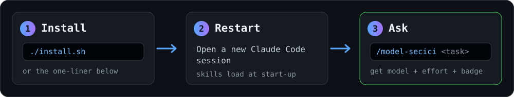
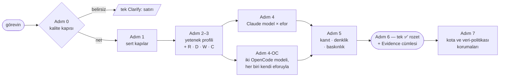

<div align="center">



<br>

[](https://github.com/enzoo808/model-effort-router/actions/workflows/checks.yml)
[](LICENSE)
[](#-kurulum)
[](#-kurulum)
[](#-kurulum)
[](CHANGELOG.md)
[](#-doğrulama)

**[Hızlı başlangıç](#-hızlı-başlangıç)** · **[Kurulum](#-kurulum)** · **[Cevabı oku](#-cevabı-okumak)** · **[Nasıl karar verir](#-nasıl-karar-verir)** · **[Örnekler](#-kullanım-örnekleri)** · **[Kanıt](#-hisle-değil-kanıtla)** · **[Değişiklik günlüğü](CHANGELOG.md)** · **[🇬🇧 English](README.md)**

</div>

<br>

> ### Bir görev yapıştır. Hangi model ve eforda çalıştıracağını öğren.
> **Claude** için *ve* **OpenCode Go** planın için — ayrıca ikisinden hangisini kullanacağını. Görevi asla çalıştırmaz, yalnızca yönlendirir.

Çoğumuz model seçimini refleksle yaparız: her seferinde en büyüğü. Bu da gerçekten tükenen iki şeyi sessizce eritir: **Claude'un 5 saatlik penceresini** ve **her OpenCode Go modelinin kendi aylık dolar limitini**.
`model-effort-router` bir [Claude skill](https://docs.claude.com/en/docs/claude-code/skills)'idir: görevi puanlar, bağımsız benchmark'larla karşılaştırır ve üç satırda cevap verir.

<div align="center">

</div>

<br>

## ⚡ Hızlı başlangıç

<div align="center">

</div>

<br>

Sistemine uyan satırı seç. İkisi de skill'i `~/.claude/skills/model-secici` içine kurar:

**macOS / Linux — klonlamaya gerek yok:**

```bash
mkdir -p ~/.claude/skills/model-secici && curl -fsSL https://github.com/enzoo808/model-effort-router/archive/refs/heads/main.tar.gz \
  | tar -xz --strip-components=2 -C ~/.claude/skills/model-secici model-effort-router-main/skill
```

**Windows (PowerShell):**

```powershell
git clone https://github.com/enzoo808/model-effort-router.git; cd model-effort-router; powershell -ExecutionPolicy Bypass -File .\install.ps1
```

`-ExecutionPolicy Bypass` yalnızca bu tek çalıştırma için geçerlidir; Windows'un varsayılan politikası yerel betikleri çoğunlukla engeller.

Sonra **yeni** bir Claude Code oturumu aç ve sor:

```text
/model-secici  Ödeme modülünü şu 40 dosyada yeni idempotency-key API'sine geçir ve testleri geçir
```

Hepsi bu. Başka bir yol mu istiyorsun (claude.ai, tek bir proje, yalnızca OpenCode)? Aşağıdaki **[Kurulum](#-kurulum)** bölümüne bak. Bir şey mi çalışmıyor? **[Sorun giderme](#sorun-giderme)**.

<br>

## ✨ Ne elde edersin

<table>
<tr>
<td width="33%" valign="top">

### 🔀 İki ekosistem, tek cevap
Bir **Claude** seçimi, sıralı **iki OpenCode modeli** (`#1`, `#2`) — her biri *kendi* eforuyla — ve **tek** ✅ öneri.

</td>
<td width="33%" valign="top">

### 🧮 Hesaplanan rozet
Ucuz ve orta zorluktaki işler OpenCode'a gider. Rozet yalnızca Claude'un *ciddi* fark yarattığı yerde Claude'a geçer ve nedenini söyler.

</td>
<td width="33%" valign="top">

### 💸 Bütçe öncelikli
Gerçekten tükenenleri korur: Claude'un 5 saatlik penceresi ve her Go modelinin **kendi dolar limiti**. Premium modeller yalnızca yükseltme içindir.

</td>
</tr>
<tr>
<td valign="top">

### 🔬 Kanıta bağlı
Bir benchmark yalnızca görevin ihtiyacını ölçüyorsa sayılır ve bir yön için **birbirinden bağımsız, uyumlu iki ölçüm** gerekir.

</td>
<td valign="top">

### 🔒 Varsayılan gizli
İstemi kaydeden ya da eğitimde kullanan modeller, *sen* "gizli değil" demedikçe dışarıda kalır.

</td>
<td valign="top">

### ✅ Doğrulanabilir
39 deterministik regresyon promptu, regex tabanlı bir not verici ve CI'da koşan tutarlılık kontrolleri — bkz. [Doğrulama](#-doğrulama).

</td>
</tr>
</table>

<details>
<summary><b>Sıradan bir "model seçici"den farkı</b></summary>

<br>

| | Sıradan "model seçici" | **model-effort-router** |
|---|---|---|
| **Kapsam** | Tek sağlayıcı, bir model adı | **İki ekosistem**, model **ve efor seviyesi**, yan yana |
| **Çıktı** | "En güçlü modeli kullan" | Claude seçimi + sıralı iki OpenCode seçimi (kendi eforlarıyla) + **tek** öneri |
| **Dayanak** | His, liderlik tablosu sırası | **Göreve bağlı kanıt**, önce karşılaştırılabilirlik |
| **Maliyet modeli** | "Ucuz olan iyidir" | 5 saatlik pencere ve **model başına dolar limitleri** |
| **Risk** | Korkutucu iş için büyük model | **Risk model katmanını değil, insan denetimini artırır** — pahalı model değil, inceleme notu alırsın |
| **Gizlilik** | Düşünülmez | **Varsayılan gizli** |
| **Dürüstlük** | Hep emin konuşur | `low-confidence` işaretler, tahmin yerine `n/p` (yayımlanmamış) der, efor basamakları arasında enterpolasyon yapmaz |

</details>

<br>

## 🚀 Kurulum

### Başlamadan önce

| Gerekenler | Neden |
|---|---|
| **[Claude Code](https://docs.claude.com/en/docs/claude-code/quickstart)** *ya da* **code execution** açık bir **claude.ai** Pro / Max / Team / Enterprise planı | Skill, Claude'un içinde çalışır. |
| `git` *(yalnızca klonlama yolları için)* | Yukarıdaki tek satır ve zip için git gerekmez. |
| Bir **OpenCode Go** planı *(isteğe bağlı)* | Yalnızca `OpenCode:` satırını *uygulamak* istersen. Router onsuz da çalışır. |

Skill'in kendisi Python, Node ya da API anahtarı istemez — metin ve JSON dosyalarından oluşan bir klasördür.

### Yolunu seç

<details open>
<summary><b>① Claude Code — her proje için</b> (önerilen)</summary>

<br>

*Kullanıcı kapsamında* kurar; `/model-secici` bu makinedeki her projede çalışır.

```bash
git clone https://github.com/enzoo808/model-effort-router.git
cd model-effort-router
./install.sh                # macOS / Linux
```

```powershell
powershell -ExecutionPolicy Bypass -File .\install.ps1   # Windows (PowerShell)
```

İki betik de `skill/` klasörünü `~/.claude/skills/model-secici/` içine kopyalar (Windows: `%USERPROFILE%\.claude\skills\model-secici\`). Ya da elle:

```bash
mkdir -p ~/.claude/skills/model-secici
cp skill/*.md skill/*.json ~/.claude/skills/model-secici/
```

**Doğrula** — `SKILL.md` doğrudan bu klasörde olmalı (alt klasörde değil):

```bash
ls ~/.claude/skills/model-secici
# SKILL.md  opencode-benchmarks.md  opencode-evidence.json  reference.md
```

Şimdi **yeni bir Claude Code oturumu başlat** (skill'ler açılışta yüklenir) ve `/model-secici <görevin>` yaz.
*"Bunun için hangi modeli kullanmalıyım?"* gibi düz sorularla da tetiklenir.

</details>

<details>
<summary><b>② Claude Code — tek proje / ekip için</b></summary>

<br>

Skill'i *deponun içine* koy; depoyu klonlayan herkes alır:

```bash
mkdir -p .claude/skills/model-secici
cp /path/to/model-effort-router/skill/*.md /path/to/model-effort-router/skill/*.json .claude/skills/model-secici/
git add .claude/skills/model-secici && git commit -m "Add model-secici skill"
```

</details>

<details>
<summary><b>③ claude.ai / Claude Desktop</b> (yerel custom skill)</summary>

<br>

1. `model-secici.zip`'i [son release](https://github.com/enzoo808/model-effort-router/releases/latest) sayfasından indir ya da `.\build-claude-ai-zip.ps1` ile üret (zip yalnız release'de üretilir, depoya işlenmez).
2. **claude.ai → Settings → Features** sayfasında **code execution**'ın açık olduğundan emin ol.
3. **Custom Skills** altında **Upload**'u seç ve zip'i yükle.
4. Bir sohbette *"şunun için hangi modeli kullanmalıyım: …"* diye sor ve görevini ekle.

Planında code execution yok mu? [`claude-ai/instructions.tr.md`](claude-ai/instructions.tr.md) içindeki düz metin yedeğini kullan.

</details>

<details>
<summary><b>④ OpenCode Go</b> — cevabı uygulamak</summary>

<br>

OpenCode tarafında skill mekanizması yok: router yalnızca bir `OpenCode:` satırı yazar, sen uygularsın.

1. Satırdaki `#1`'i al, örneğin `DeepSeek V4.1 Flash · effort: max`.
2. OpenCode'da modeli **`opencode-go/<model-id>`** olarak seç.
3. Router'ın yazdığı efor görünene kadar **`variant_cycle`** (`ctrl+t`) ile eforu değiştir — ya da doğrudan `#variant` ile seç: `opencode run --model opencode-go/deepseek-v4.1-flash#high "…"` (aynı `provider/model#variant` biçimi ajan ve komut `model` alanlarında da geçerli; kök `model` ayarı varyantı tutmaz).
   MiMo-V2.6'nın varyantı yoktur (düşünme hep açık), bu yüzden router `default` yazar ve çevrilecek bir şey olmaz.
4. `#1` hata verir ya da aşırı yüklüyse `#2`'yi kullan. Bir modelin aylık penceresi bittiyse ya da sonucu yetersiz kaldıysa router'a söyle ([Prompt nasıl yazılır](#prompt-nasıl-yazılır)): zincirdeki sıradaki modeli söyler ya da yükseltir.

</details>

### Güncelle · kaldır

**Güncelle** — kullandığın yolu tekrarla. Tek satırla mı kurdun? Hızlı başlangıçtaki komutu yeniden çalıştır. Klondan mı kurdun?

```bash
cd model-effort-router && git pull && ./install.sh
```

Windows'ta `git pull` yap, sonra `powershell -ExecutionPolicy Bypass -File .\install.ps1` komutunu yeniden çalıştır.

**Kaldır:**

```bash
rm -rf ~/.claude/skills/model-secici
```

Windows'ta `%USERPROFILE%\.claude\skills\model-secici` klasörünü sil.

### Sorun giderme

| Belirti | Çözüm |
|---|---|
| `/model-secici` listede yok | **Yeni** bir oturum başlat — skill'ler açılışta yüklenir. Sonra `~/.claude/skills/model-secici/SKILL.md` dosyasının var olduğunu kontrol et (`.../model-secici/skill/SKILL.md` değil). |
| Tek satır hiçbir şey çıkarmıyor | `curl` ve `tar` `PATH`'inde olmalı; Windows'ta PowerShell satırını ya da zip'i kullan. |
| `install.ps1` \"running scripts is disabled\" hatası veriyor | Bypass bayrağı olmadan çalıştırmışsın: `powershell -ExecutionPolicy Bypass -File .\install.ps1` |
| claude.ai yüklemeyi "invalid characters" diye reddediyor | Zip'i `build-claude-ai-zip.ps1` ile üret; düz bölü yazar. Windows'un kendi araçlarıyla yapılan zip'ler ters bölü kullanır. |
| Yalnızca bir `Clarify:` satırı yazıyor | Tasarım gereği: prompt belirsizdi. Soruyu cevapla ve yeniden sor — bkz. [prompt nasıl yazılır](#prompt-nasıl-yazılır). |
| Düz bir soruda tetiklenmiyor | Açık `/model-secici …` komutunu kullan. |

<br>

## 🔎 Cevabı okumak

```text
Claude:   Sonnet 5.5 · effort: high
OpenCode: ✅ RECOMMENDED AI · #1 MiMo-V2.6-Pro · effort: default · #2 DeepSeek V4.1 Flash · effort: max
Evidence: Mid-difficulty feature work stays on OpenCode (SM1): Claude's lead on Vals TB 4.0 (65 / 64 vs 31 / 32) and Arena Agent only counts from D=3, and a real agent task costs USD 0.17 (MiMo-V2.6-Pro) against Sonnet 5.5's 3.38 and Opus 5.5's 5.38 (Arena, 10 Nov).
DeepSeek V4.1 Flash: peak hours cost 2× (04–07 and 09–13 TR time, Mon–Fri); …
```

| Satır | Ne söyler |
|---|---|
| `Claude:` | Claude'u seçersen kullanacağın tek Claude modeli ve eforu. |
| `OpenCode:` | Sıralı **iki** Go modeli — `#1` seçimdir, `#2` yedek adaydır (`#1` hata verir ya da aşırı yüklüyse onu kullan) — her biri OpenCode'un o model için gerçekten sunduğu eforla (`low` / `high` / `max`, `xhigh` ya da `default`). |
| `✅ RECOMMENDED AI` | Kullanılacak ekosistem. **Claude ciddi fark yaratmıyorsa OpenCode.** Tam olarak bir rozet. |
| `Evidence:` | Rozeti hangi ölçümün belirlediğini söyleyen tek cümle. `low-confidence`, kanıtın zayıf olduğu anlamına gelir. |
| *Ek satırlar* | Yalnızca önemliyse eklenir: yüksek riskte insan inceleme notu, DeepSeek'in yoğun saat fiyatı, `/fast` uygunluğu, `Ultracode:` ipucu, veri-politikası uyarıları. |
| `Clarify:` | Prompt yönlendirmek için fazla belirsizse yukarıdakilerin hepsinin yerine. |

*(Skill çıktısı İngilizcedir; promptu hangi dilde yazarsan yaz yönlendirir.)*

> **Claude satırı `· ultracode` ile bitiyorsa** router bir `Ultracode:` satırı ekler. Sonra Claude Code'da çalıştıracağın promptun başına `ultracode:` yaz; böylece *yalnızca o görev* iş akışı olarak çalışır. `/effort ultracode` ise oturum boyunca açık kalır ve limitlerini daha hızlı tüketir.

### Prompt nasıl yazılır

Router, sözlerinden dört şeyi puanlar: Risk (**R**), Derinlik (**D**), Genişlik (**W**) ve Bağlam (**C**). Bu yüzden şunları söyle:

- **Ne ve ne kadar büyük** — yalnızca "refactor" değil, "40 dosya", "400 sayfa", "200 yorum".
- **Bitmiş hali nasıl görünür** — "test paketi geçsin", "tek bir mutabakat tablosu".
- **Riskler** — "bu gece prod'a gidiyor", "etiketler baskıya gidiyor".

Cevabı değiştiren sözler:

| Söyle | Etki |
|---|---|
| *"bu iş gizli değil"* | İstemleri saklayan ya da eğitimde kullanan GPT 6 Luna ve Muse Spark 1.3'ü açar. Üslupla asla varsayılmaz. |
| *"önceki bir OpenCode denemesi yetersiz kaldı"* | Yükseltir: `#2` premium bir OpenCode modeli olur. `D ≥ 2`'de görevin ana yeteneğinin bir Claude satırı varsa rozet Claude'a geçer. |
| *"DeepSeek pencerem doldu"* (herhangi bir model) | `Evidence:` satırı o modelin zincirindeki sıradaki modeli söyler. |

<br>

## 🧭 Nasıl karar verir



Her görev dört eksende, 0–3 arası puanlanır:

| Eksen | Hangi soruyu cevaplar | Neyi belirler |
|---|---|---|
| **R** — Risk | Yanlış cevap ne kadar pahalı? | İnsan inceleme notu (asla daha büyük model değil) |
| **D** — Derinlik | Düşünme ne kadar zor? | Model katmanı ve efor seviyesi |
| **W** — Genişlik | Kaç bağımsız parça ya da faz var? | `ultracode` iş akışı bayrağı, `opusplan` |
| **C** — Bağlam | Ne kadarı sığmalı? | Bunu taşıyabilen modeller |

Karar ilkesi tek cümlede:

> **Görevin yetenek sınırında kalan en düşük kotalı model × efor birleşimini seç.** Göreve ilişkin fark anlamlıysa güçlü adayı, yetenek savunulabilir bir denklik bandının içindeyse kota açısından verimli olanı tercih et.

"Hep en ucuz" değil. "Hep en güçlü" değil. "En yüksek benchmark kazanır" da değil.
Her kapı ve kural dahil adım adım ayrıntı: **[docs/how-it-works.md](docs/how-it-works.md)** (İngilizce).

<br>

## 🧪 Kullanım örnekleri

| Görev | Claude | OpenCode `#1` · `#2` | Önerilen |
|---|---|---|---|
| 200 yorumu olumlu/olumsuz etiketle | `Haiku 5.5 · low` | DeepSeek V4.1 Flash `low` · MiMo-V2.6-Flash `default` | **OpenCode** — `D=0` toplu iş; USD 60 limitli Flash katmanı Claude kotasını korur |
| Ödeme modülünü 40 dosyada yeniden düzenle | `Sonnet 5.5 · high` | MiMo-V2.6-Pro `default` · DeepSeek V4.1 Flash `max` | **OpenCode** — `D=2`; Claude'un önü `D=3`'ten itibaren sayılır, görev başına USD 0.17 vs 3.38 |
| Staging'i sıfırdan kur (Terraform, 12 servis, seed, smoke) | `Sonnet 5.5 · high · ultracode` | MiMo-V2.6-Pro `default` · DeepSeek V4.1 Flash `max` | **Claude** — çok fazlı; `ultracode`'un OpenCode karşılığı yok |
| Prod'da ara sıra patlayan race condition'ı bul | `Opus 5.5 · xhigh` | MiMo-V2.6-Pro `default` · DeepSeek V4.1 Flash `max` | **Claude** — `D=3`, uyumlu iki AA satırı |
| Geri döndürülemez işlem sınırını tasarla | `Opus 5.5 · max` + inceleme notu | MiMo-V2.6-Pro `default` · DeepSeek V4.1 Flash `max` | **Claude** — `D=3`, `R=3` |
| 200 servis için auth'u sıfırdan yeniden tasarla | `opusplan · plan: max · execute: medium` | MiMo-V2.6-Pro `default` · GLM-5.3-Flash `max` | **Claude** — `opusplan` mekanizması |
| Bir CVE için exploit PoC | `Opus 4.8 · xhigh` | `use Claude` | **Claude** — OpenCode bu kapıyı reddeder |
| *"Şu kodu düzelt"* | *(model yok, rozet yok — sorar: hangi kod? nasıl bozuk? bitti ne demek?)* | | |

Daha fazla örnek (20 satırlık tam tablo) için [İngilizce README](README.md#-examples).

<br>

## 🧱 Model havuzu

**Claude kolu** — derinlik ve bağlama göre bir model ve bir efor:

| Model | Rol |
|---|---|
| **Haiku 5.5** | Küçük, sığ işler için maliyet seçimi (`D ≤ 1` okuma ve dönüştürme işleri) |
| **Sonnet 5.5** | Günlük iş, varsayılan başlangıç |
| **Opus 5.5** | Zor ajan tabanlı kod için amiral gemisi (`D = 3`) |
| **Opus 4.8** | Eski — yalnızca saldırgan güvenlik kapısı için tutulur (`/fast` 30 Kasım 2026'da bitiyor) |
| **Fable 5.2** | Devasa ölçek (1000+ dosya) ve biyolojiye komşu Ar-Ge (USD 8/40; `/fast` var) |
| **Mythos 5.2** | Gevşek korumalı Fable 5.2 — yalnızca Life Sciences Verification Program |

**OpenCode Go kolu** — **puanlanan 19 model**, katmanlara ayrılmış. Her Go modelinin *kendi* aylık dolar limiti vardır; önemli olan o limitin bir ayda kaç *gerçek* ajan görevi aldığıdır. Katman üyeliği **isimle** belirlenir (Kural BUD1); aşağıdaki görev sayıları 10 Kasım 2026 tarihli, her satırı aynı sayfadan alınmış tek bir Arena anlık görüntüsüdür ve yalnızca bilgi amaçlıdır:

| Katman | Modeller | Rol |
|---|---|---|
| **Bütçe** — varsayılan çiftler | MiMo-V2.6-Flash 857 · DeepSeek V4.1 Flash 714 · GLM-5.3-Flash 375 · MiMo-V2.6-Pro 88 | Limit başına ayda 88–857 görev |
| **Yalnızca gizli olmayan iş** | GPT 6 Luna 188 · Muse Spark 1.3 128 | İşin gizli olmadığını söylersen sunulur — bazıları istemlerle eğitilir |
| **Premium** — yalnızca yükseltme | Kimi K3 18 · GLM-5.3 13 · Qwen3.8 Max 12 · Kimi K3.1 Pro 12 · Grok 4.7 5 | Limit başına ayda 5–18 görev; yönlendirilen çiftte asla yok, yalnızca bildirilen bir yetersizlikten sonra `#2` |
| **Gemini (GM1)** — kaplama | Gemini 4 Argon | Go'nun düz `gemini-4-argon`u (Not used / 0 gün), gizli işe açık; yalnızca beş satırda `D = 3` / `R = 3` için `#1`, USD 30 limit — varsayılan çift değil |
| **Puanlanmamış** — asla seçilmez | Qwen3.8 Flash | Bu ad altındaki her satır "Qwen3.8-Flash-Next", farklı bir açık ağırlıklı model; `n/p` |
| **Baskın olunan** | DeepSeek V4 Pro · MiniMax M3 · Kimi K2.7 Code · Qwen3.7 Plus · Claude Haiku 5.5 · Gemini 3.8 Flash | Puanlanır ve izlenir; hiçbir satır bunları üretmez |

> Efor, OpenCode'un o model için *gerçekten sunduğu* varyanttır (`low` / `high` / `max`, `xhigh` ya da `default`); asla reddedeceği bir değer yazılmaz. DeepSeek V4.1 Flash `D ≤ 1` için `low`, `D ≥ 2` için `max` yazar (`high` sunulur, asla yazılmaz: AA-Briefcase ve Vals Terminal-Bench 4.0 etkinlik grafiği onu `max`'tan ayırır; iteration-26'nın üç kademeli kuralı geri alındı). DeepSeek'in limiti USD 100 ve sıfır-saklama anlaşması 30 Kasım 2026'ya kadar geçerli. Go DeepSeek V4.1 Flash'ın **1017** sürümünü sunuyor; router'ın andığı her DeepSeek rakamı 1017 rakamıdır (eski sürüm rakamları hiçbir satırı veya rozeti desteklemez).

<br>

## 🔬 Hisle değil, kanıtla

> **Kanıt yönü ve denklik bandını belirler; yetenek profili hangi kanıtın geçerli olduğunu söyler; verimlilik, yeteneğin açık bıraktığı eşitlikleri çözer. Tek başına bir liderlik tablosu sırası hiçbir şeyi belirlemez.**

- **Benchmark'lar yeteneğe bağlanır.** Saf matematik promptunda Terminal-Bench'in ağırlığı sıfırdır.
- **Önce karşılaştırılabilirlik.** İki sayı karşılaştırılmadan önce benchmark, sürüm, harness, araç erişimi, iskele *ve* efor eşleşmelidir.
- **AA Intelligence Index v5 ayrı sütunda yaşar.** Tüm v4.3.2 II / TB / USD-görev-başı rakamları **dondurulmuştur**; v5 sütunu yalnızca 10 Kasım 2026'da yeniden okunanı taşır ve iki sürüm asla karşılaştırılmaz.
- **AA Elo aralıkları eşitliği çözer.** AA her satır için bir Elo aralığı yayımlar; bu aralığın içinde kalan fark, ne kadar büyük görünürse görünsün bir yön değildir.
- **Bağımsız kaynaklar yönü belirler.** Artificial Analysis, DeepSWE v1.1 (hata payıyla), Agent Arena, Vals, FrontierSWE v2, ARC-AGI, Gray Swan — [`skill/opencode-evidence.json`](skill/opencode-evidence.json) içinde derlenir. Bir sağlayıcının aynı rakamı yeniden anması iki değil, bir sayıdır. Sağlayıcının bildirdiği efor eğrileri yalnızca bir efor basamağı seçmek için kullanılır, asla bir yön belirlemek için değil.
- **Yön için uyumlu iki bağımsız ölçüm gerekir.** Tek bir ölçüm yalnızca `R = 3`'te karar verir.
- Efor basamakları arasında **enterpolasyon yok**; `n/p` (yayımlanmamış) bir cevaptır.
- **Toplam endeks hiçbir zaman yön belirlemez** — yalnızca verimlilik eşitlik bozmasına izin verir.

Ham sayılar [`skill/opencode-benchmarks.md`](skill/opencode-benchmarks.md) ve [`skill/reference.md`](skill/reference.md) içindedir. Bunlar denetim verisidir ve yönlendirmek için **asla yüklenmez**; bu da bir yönlendirme çağrısının token maliyetini düşük tutar.

<br>

## ✅ Doğrulama

`evals/routing/evals.json`, saf regex ile (döngüde LLM yok) notlanan deterministik bir regresyon setidir — **39 prompt**. Claude modelini ve eforunu, **her iki OpenCode seçimini** (model, efor, sıra), rozetin hangi tarafta olduğunu, anlamlı bir `Evidence:` satırını ve gizlilik varsayılanı için zorunlu / yasak metni denetler.

```bash
python evals/routing/grade_routing.py --selftest --results-dir /tmp/x   # altın çıktılar vs not verici
python scripts/check_policy_sync.py      # SKILL.md kural blokları == evals/policy/routing_policy.json
python scripts/check_opencode_pool.py    # havuz, Adım 4-OC satırları, rozet tablosu, model başına varyantlar
python scripts/check_examples.py         # her çalışılmış örnek kendi altın çıktısıyla uyuşur
python scripts/check_readme_facts.py     # dokümandaki sayılar, havuz boyutu, iterasyon ve katman tabloları veriyle uyuşur
```

Bunlar, [`checks.yml`](.github/workflows/checks.yml)'nin her push ve pull request'te çalıştırdığı kontrollerin aynısıdır. Yetenek başına bağımsız kanıt uzlaşısını yazdırmak için: `python scripts/derive_opencode_rows.py`.

**Durum (12 Kasım 2026, iteration-29):** yukarıdaki kontrollerin hepsi `check_readme_facts.py` dahil geçiyor; `--selftest` **39/39**. OpenCode satırında DeepSeek bulunan **18 promptun** soğuk koşusu (her prompt için taze bir ajan, yalnızca `skill/SKILL.md` okuyarak) **17/18**; tek hata (`w4`, atlanan Zen ikizi) yeniden koşuda **3/3** geçti. `i1` atlandı, tetikleme eval'i hâlâ bir vekil. Ayrıntılar [`evals/README.md`](evals/README.md)'de.

### Bilinen sınırlar

- **Tetikleme eval'i bir vekildir.** İç içe `claude -p` derleme ortamında kimlik doğrulayamıyor; gerçek sayı için `evals/trigger/run_trigger.py`'yi oturum açmış bir terminalden çalıştır.
- **Biyoloji kapısı `high` eforuna sabittir.** Biyoloji sınıflandırıcıları araştırma görevlerini engelleyebilir: ilk işaretlenen istekte Claude Code oturumu Opus 5'e taşır, sonraki biyoloji işaretli istekler reddedilir. Kapı, D tablosunun `xhigh`'ını almaz: Anthropic'in vendor-raporlu tablosunda Fable 5.2 `high` ile Opus 5.5 `max`, FrontierCode 2.0'da eşleşiyor ve Fable ayrı bir haftalık limitten harcıyor.
- **1000+ dosya kapısı normal D basamağını kullanır.** Modeli Fable 5.2 yapar, eforu değil: D=3'te `xhigh`, `max` yalnız M1 altında, 30 dakika üstünde `ultracode`. Bu bir ölçek kapısıdır, sınıflandırıcı istisnası değil; mekanik 1000 dosyalık yeniden adlandırma kendi D basamağında kalır.
- **Fiyatlar, limitler ve saklama koşulları tarihlidir.** Anlık görüntüdür (her satırın tarihine bak) ve OpenCode Go bunları değiştirebilir — birincil kaynaklı düzeltmeler en değerli katkıdır.
- **Varsayılan OpenCode bir ödünleşimdir.** `D = 2`'de router kodlamayı OpenCode'a yollar; oysa Claude en zor görev ölçütlerinin bazılarında hâlâ önde. Sebep, orta zorluktaki DeepSWE karşılaştırmasının maliyetin çok altında eşit çıkmasıdır. Orada Claude'a ödemeyi tercih edersen bu, [`skill/SKILL.md`](skill/SKILL.md) içindeki rozet tablosunun tek satırıdır.
- **Yönlendirmede tek doğruluk kaynağı `SKILL.md`'dir**; `claude-ai/` yedeği elle senkronlanan bir türevdir.

<br>

## 🗂 Depo haritası

```text
skill/                       Skill'in kendisi — yönlendirirken yalnızca SKILL.md okunur
  SKILL.md                   Yönlendirme kuralları (tek doğruluk kaynağı)
  opencode-benchmarks.md     OpenCode kanıtı, model başına, kaynaklarıyla
  opencode-evidence.json     Kontrollerin türetildiği makine-okunur kanıt
  reference.md               Claude fiyat, limit, benchmark notları (denetim verisi)
evals/                       Regresyon seti, not verici, politika aynası, son koşu geçmişi
scripts/                     Tutarlılık kontrolleri ve kanıt araçları
docs/                        Nasıl çalışır, görseller, lansman notları
dist/model-secici.zip        claude.ai'a yüklemeye hazır skill (yalnız release'de üretilir)
claude-ai/                   Code execution kapalıyken düz metin yedeği
install.sh · install.ps1     Claude Code için tek komutla kurulum
.github/workflows/          CI: yukarıdaki kontroller her push ve pull request'te
CHANGELOG.md                 Her politika iterasyonu, en yeni en üstte
```

## 🤝 Katkı

Model özelliklerinde, fiyatlarda, limitlerde, saklama koşullarında, efor varsayılanlarında ya da **benchmark kayıtlarında** düzeltmeler çok değerlidir — birincil kaynağı belirt, sayının yanına harness, efor ve tarihi yaz. Kural değişiklikleri yukarıdaki kontrolleri yeşil tutmalı. Bkz. **[CONTRIBUTING.md](CONTRIBUTING.md)**.

## 📄 Lisans

MIT — bkz. [LICENSE](LICENSE).

<div align="center">
<br>

*Cüzdanını değil, hız-limit pencerelerini korur.*

</div>
